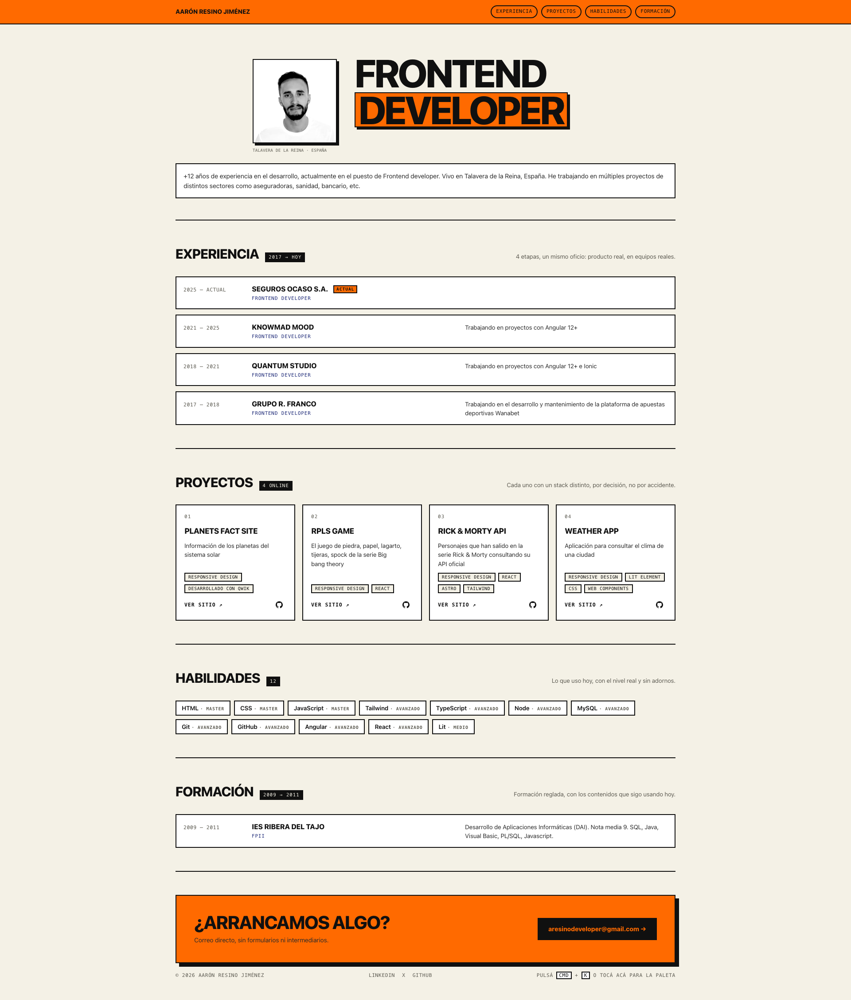

<div align="center">

  <h1>Portfolio de Aarón Resino Jiménez</h1>

  <p>Frontend developer · Talavera de la Reina, España</p>

  <p><a href="https://aresino.dev">aresino.dev</a></p>

</div>

<p align="center">
  
</p>

<p align="center">
  <br />
  <sub>Construido con la ayuda de</sub><br />
  <a href="https://github.com/Gentleman-Programming/gentle-ai"></a>
</p>

---

Este repositorio es el código de mi portfolio. No es una plantilla ni un producto: es una
página estática que cuenta doce años de frontend, y todo lo que se lee en ella sale de un
único archivo de datos.

## Qué hay dentro

- **Hero** con retrato, titular y un resumen de quién soy y en qué sectores trabajo.
- **Experiencia**: las etapas desde 2017, con el puesto y qué hice en cada una.
- **Proyectos**: cuatro piezas publicadas, cada una con su stack y su repositorio.
- **Habilidades**: doce tecnologías con el nivel real, sin porcentajes inventados.
- **Formación**: la titulación con sus contenidos.
- **Contacto**: correo directo, sin formularios.

La página es navegable con teclado: la paleta de comandos abre con <kbd>Cmd</kbd> +
<kbd>K</kbd> y desde ahí se salta a los perfiles o se imprime el CV.

## Stack

| Pieza | Versión | Para qué |
| :---- | :------ | :------- |
| [**Astro**](https://astro.build/) | 7.4.12 | Genera la página estática y optimiza la imagen del retrato |
| [**TypeScript**](https://www.typescriptlang.org/) | 5.9.3 | Tipado de los datos y de los componentes |
| [**Node**](https://nodejs.org/) | 24.22.3 (LTS) | Entorno de build; fijado en `.nvmrc` |
| [**Ninja Keys**](https://github.com/ssleptsov/ninja-keys) | 1.2.2 | Paleta de comandos con atajos de teclado |

Sin framework de UI, sin Tailwind y sin dependencias de runtime: CSS propio con variables y
componentes de Astro.

## En local

```bash
nvm use          # Node 24, el que fija .nvmrc
npm install
npm run dev      # http://localhost:4321
```

## Comandos

| Comando | Acción |
| :------ | :----- |
| `npm run dev` o `npm start` | Servidor de desarrollo en `localhost:4321` |
| `npm run build` | Comprueba tipos (`astro check`) y empaqueta producción en `./dist/` |
| `npm run preview` | Sirve el resultado del build en `localhost:4321` |

## El contenido vive en `cv.json`

Experiencia, proyectos, habilidades y formación se leen de ahí: editar el JSON cambia la
página. Las etiquetas de sección —el rango de años, cuántos proyectos están en línea— se
calculan a partir de los datos, no están escritas a mano.

El retrato es `src/assets/retrato.jpg`: Astro lo optimiza en el build y el CSS lo pasa a
blanco y negro para que el único color de la página sea el naranja.

## Deploy

En Netlify, con deploy preview por pull request. El build exige **Node ≥ 22.23.4**; el
`.nvmrc` y el campo `engines` de `package.json` lo dejan declarado.

## Licencia

[MIT](LICENSE.txt).
